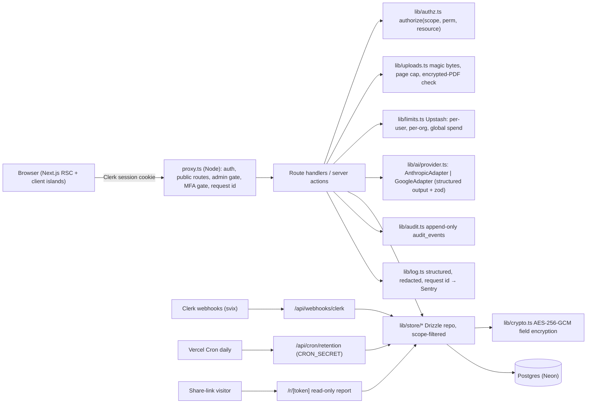
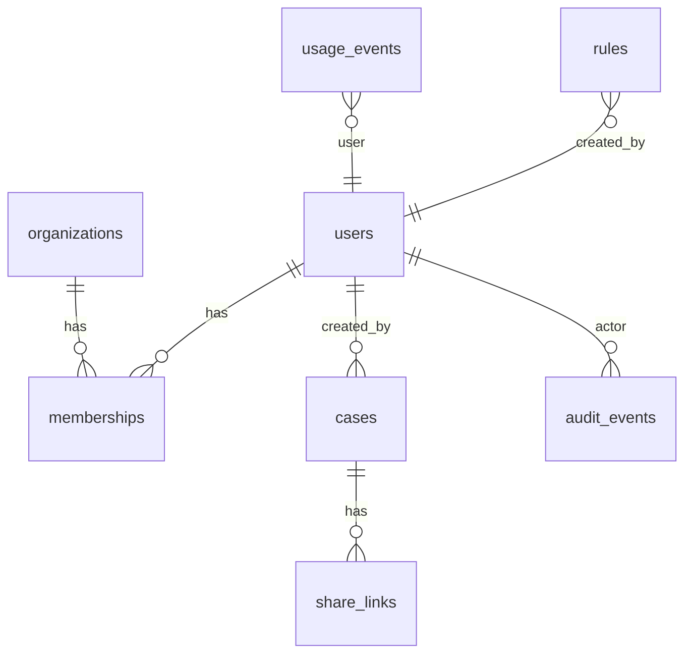

# ConcretePOA v1: Implementation Plan

**Status:** DRAFT, awaiting owner approval. No application code has changed yet.
**Branch:** `release/v1`, cut from `cursor/next-secure-saas-a13b` @ `5ccee0b` (PR #3).
**Date:** 2026-10-24

---

## 0. Phase 0 findings (emergency containment)

| Check | Result |
|---|---|
| Live site `concrete-poa.vercel.app` | Still serves the **Vite** build (`/assets/index-ChrO7tsq.js`). PR #3 has not been promoted. |
| Live bundle secret scan | **1 match** for the Google API key pattern `AIza[0-9A-Za-z_-]{35}` in `/assets/index-ChrO7tsq.js`. **The key is exposed right now.** |
| Git history, all 14 commits on all 5 branches | **0 matches** for `AIza…`, `sk-ant-…`, `sk_live_…`, `sk_test_…`, `pk_live_…`. The key was injected at build time from the Vercel env var. It was never committed. |
| PR #3 client code | No client component imports `@anthropic-ai/sdk`, reads `process.env.*_KEY`, or uses `define`. `lib/ai/analyze.ts`, `lib/config.ts`, `lib/store.ts`, `lib/api.ts`, and `lib/session.ts` import `server-only`. A build-output scan of `.next/static` is in §0.3 (results in the Phase 0 report). |

### 0.1 Steps for you: rotate the Gemini key (do this today)
1. Google Cloud console → **APIs & Services → Credentials** (or AI Studio → **API keys**) → find the key used by the Vercel project → **Delete** it. Restricting the key isn't enough, because it's already public.
2. Check **APIs & Services → Metrics / Billing** for unexpected Generative Language API usage since March 2026. Set a budget alert.
3. Vercel → Project → Settings → Environment Variables → **delete `GEMINI_API_KEY`** in all environments. Neither branch reads it anymore once v1 ships.
4. Expect the live Vite site's analysis to start failing as soon as the key is deleted. That's the intended containment. **Optional (needs your OK, since it changes production):** I can push a one-file static "Back soon" page to `main` so users don't hit broken uploads in the meantime.
5. If Gemini is chosen as the v1 provider (Q1), create a **new** key restricted to the Generative Language API, on a **paid** billing account (so prompts aren't used for training), stored only as a server env var.

### 0.2 Steps for you: promote the Next.js build (Phase 6, not now)
1. Merge `release/v1` → `main` through a PR once Phase 6 is signed off. Vercel's production branch stays `main`, so no Vercel production setting changes.
2. Confirm Vercel → Settings → **Framework Preset = Next.js** (commit `5ccee0b` already sets this for previews), Build Command `next build`, Output default.
3. After the deploy, check `curl -s https://concrete-poa.vercel.app | grep -c '/assets/index-'` returns `0` and `/_next/static` is served.
4. Rollback: Vercel → Deployments → the previous production deployment → **Instant Rollback** (this brings back the Vite build, which no longer works once the key is rotated, so treat rollback as "maintenance mode").

### 0.3 Secret scanning (added in Phase 1, run once in Phase 0)
`scripts/scan-secrets.mjs` scans tracked source **and** `.next/static/**` for `AIza[0-9A-Za-z_-]{35}`, `sk-ant-[A-Za-z0-9_-]{20,}`, `sk_live_`, `sk_test_`, `whsec_`, `-----BEGIN .* PRIVATE KEY-----`, and any value of a known server env var name. It exits non-zero on a hit and prints only file:line plus a redacted prefix. CI runs it after `next build`. GitHub secret scanning and push protection should also be on in the repo settings (your action).

### 0.4 PR recommendations (you do the closing)
- **Close PR #1** (`cursor/vite-remote-host-0260`): a dev-only Vite host change, obsolete once the app is on Next.js.
- **Close PR #2** (`cursor/auth-tenant-login-0260`): fake client-side auth with plaintext demo passwords in the bundle. **Must not merge.** One idea worth keeping is DOCX upload via mammoth (commit `8a0359e`). It's out of v1 scope (v1 accepts PDF, PNG, JPEG), and it's listed as a v1.1 candidate.
- **Leave PR #3 open as a draft** until `release/v1` merges, then close it as superseded. Don't delete branches; I'll ask before any deletion.
- `claude/ai-infrastructure-landing-page-LfG4t`: superseded. Leave it; you can delete it whenever you like.

---

## 1. Audit of PR #3 (`cursor/next-secure-saas-a13b`)

Your description is mostly accurate. Corrections and additions below. Items marked **NEW** weren't in the brief or `gap_audit.md`.

### 1.1 Corrections to the brief
| Brief says | Code actually has |
|---|---|
| Workspace pages: dashboard, analyze, history, library, cases/[id], settings | `app/(workspace)/`: `dashboard`, `cases` (list), `cases/new` (analyze), `cases/[id]`, `rules` (library), `settings`. There's also an unauthenticated `app/demo/*` tree gated by `DEMO_SCREENSHOT=1`. |
| API routes include `app/api/cases` | There's **no** `app/api/cases/route.ts`. Listing is server-rendered via `lib/store.listCases`. The routes are `analyze`, `cases/[id]` (GET, DELETE), `cases/[id]/export`, `cases/import-demo`, `rules` (GET, POST). |
| shadcn-style UI in `components/ui/*` | Only `button.tsx` and `badge.tsx`. There's no Dialog, Input, or Select, and no focus-trapped modal. We add Radix-based primitives as needed. |
| Rate limiting "with Upstash Redis" | There's no `@upstash/*` dependency. It's a hand-rolled REST `INCR/EXPIRE` pipeline that silently falls back to memory on any error. We'll swap it for `@upstash/ratelimit` (sliding window, multi-key). |
| Only 6 banks are exposed | That's true on `main`. **PR #3 already exposes all 15 banks plus "Other"** in `components/upload-panel.tsx`, and all 15 appear in the library. |
| Jurisdiction hints cover CA/NY/FL/TX only | That's true for the prompt hints (`lib/knowledge.ts`). But `lib/library.ts` has chapter-level checkpoints for **12** jurisdictions: AZ, CA, FL, IL, NJ, NY, NC, OH, PA, TX, WA, and "Unstated". None quote statute text. |
| `metadata.json`, `express`, `dotenv`, `@google/adk` need removing | Already gone on PR #3. G4 is reduced to the README, `.env.example`, and docs. |
| The score is a "0–100 friction score" | The code and UI use **`acceptanceProbability`** (higher is better). See Q7. |

### 1.2 Confirmed gaps (B1–G5 all reproduce)
- **B1** `requireWorkspace()` checks only `userId` and `orgId`. DELETE, rule POST, and import-demo have no role check.
- **B2** `hidePersonal` appears in both places, and `requireWorkspace()` returns **400** (not 403) without an org.
- **B3/B4** No webhooks, mirror tables, or admin.
- **C1** `dataMode()` and `store.ts` fall back to memory when `DATABASE_URL` is unset. The rate limiter falls back to memory on unset vars *and* on any Upstash error.
- **C2** The schema is as described. `year: 2026` is hardcoded in `app/api/rules/route.ts` and `lib/library.ts` (`const YEAR = 2026`).
- **D1** `prompts.ts:14` interpolates raw text inside quotes.
- **D2** The rubric **is** injected (`auditKnowledgePreamble` → `INSTITUTIONAL RUBRIC`, asserted in `verify-lib`). D2 is fixed on PR #3, except for custom rules (see NEW-3).
- **D3** "CURRENT 2026", "March 2026", and `statutoryYear 2026` are hardcoded in the prompt, and `normalizeJurisdiction` defaults to 2026.
- **D4** Brace-regex parsing is confirmed.
- **D5** Every failure returns 400 from the analyze catch. Client timeout is 55 s against a 60 s `maxDuration`.
- **E1** `normalizeMime(file.type)` trusts the browser.
- **F6** `CopyButton` has no try/catch on `navigator.clipboard.writeText`.
- **G2** `next.config.ts` has no headers.
- **32** `app/privacy/page.tsx` names `DATABASE_URL` and `ANTHROPIC_API_KEY` in user-facing copy.

### 1.3 NEW findings
1. **NEW-1 Silent sample fallback in production.** If `ANTHROPIC_API_KEY` is unset, `analyzeUpload` returns a canned sample report and **saves it as a real matter** (`status: "sample"`). The UI badges it, but in production it should fail closed with a 503 "analysis unavailable". Sample mode stays for local dev and tests only.
2. **NEW-2 Full document text is persisted.** The audit prompt still says "Extract the full raw text of the document", and `auditResultSchema.extractedData.rawText` (up to 20,000 chars) is stored inside the `findings` jsonb. That's a data-minimization breach (§8) on top of C3. Fix: remove `rawText` from the prompt and schema. Legacy rows get it stripped in the migration backfill.
3. **NEW-3 Saved workspace rules are never sent to the model.** Rules created in `/rules` are only displayed. The model receives the free-text "notes" box (`customRules`) and the built-in rubric, nothing else.
4. **NEW-4 Normalization defeats validation.** `normalizeAudit/Rejection/Jurisdiction` coerce every missing field to `""` or `0` *before* `zod.parse`, so a near-empty model response passes validation and renders as a blank report with score 0. That's the same class of bug as `main`'s `{}` fallback. Fix: validate the raw structured output strictly first, and only clip lengths afterwards.
5. **NEW-5 PII in titles and export filenames.** `record.title` = `"<principal name> · <bank>"`. It's stored in plaintext, shown in lists, and **slugged into the export filename** (`export/route.ts`, `case-report.tsx slug()`). That's the same leak as `main`'s `Affidavit_<name>.txt`. Fix: titles become encrypted, and export names become `concretepoa-<mode>-<shortid>.pdf`.
6. **NEW-6 `fileName` stored in plaintext.** Uploaded filenames often contain the principal's name (`Smith_POA_2019.pdf`). Fix: don't store it. Keep only extension and size.
7. **NEW-7 Org-required API returns 400 for missing workspace** and 400 for store outages (`CASE_STORE_UNAVAILABLE`). These get folded into the D5 taxonomy (403 / 503).
8. **NEW-8 Sentinel errors through `Error.message` strings** (`"NO_DATABASE"`, `"WORKSPACE_NONEMPTY"`). These get replaced with typed `AppError` classes.
9. **NEW-9 Import-demo writes synthetic matters into any real workspace**, including production. Fix: allow it in dev and preview only, behind `case:create`.
10. **NEW-10 `VITE_CLERK_PUBLISHABLE_KEY` fallback** in `config.ts` and `proxy.ts`. It's harmless (publishable), but it's legacy. Remove it once Vercel is renamed (env list §10).
11. **NEW-11 Possible encoding issue.** The title separator and some `knowledge.ts` dashes look mojibake'd (`·`, `â€"`) when read as UTF-8 on Windows. I'll check the byte encoding in Phase 1 and normalize to UTF-8.

### 1.4 What PR #3 lost from `main` (to port)
| From `main` | Disposition |
|---|---|
| Uploaded-document preview (object URL + modal) | Port into the analyze flow as an accessible preview before submit, with object URLs revoked on change and unmount (F4). |
| Separate audit, rejection, and jurisdiction history lists | PR #3 has a unified matters list. We keep it unified and add a mode filter (meets F4's "own search per list" intent). |
| "Add custom bank" (name, age limit) | Rebuilt properly as a **custom bank** rule kind with clauses, formatting, age limit, and friction rules (F3). |
| Synthetic samples `public/samples/poa/*.txt` | Present on PR #3. Used to seed `evals/`. |
| Affidavit `.txt` download | PR #3 has copy and MD/PDF export. We keep those, relabeled "Draft template for attorney review" (D8). |

### 1.5 What works and stays
These stay with surgical edits only: `lib/ai/prompts.ts` structure, the three zod result schemas (extended additively), `lib/report.ts` (PDF/MD export), `lib/library.ts` + `lib/banks.ts` (become seed data for the `rules` table), `components/case-report.tsx`, `case-list.tsx`, `dashboard-view.tsx`, `rule-library.tsx`, `upload-panel.tsx`, the Clerk sign-in/sign-up pages, and the `proxy.ts` Node runtime setup.

---

## 2. Architecture



### 2.1 Module layout (new or changed)
```
lib/
  env.ts            zod-validated env; fail-closed in production (C1, DEMO gate)
  errors.ts         AppError taxonomy → HTTP (D5)
  log.ts            JSON logger, allowlisted fields only, request id (rule 8)
  authz.ts          permission matrix + authorize() (B1)
  scope.ts          requireScope(): personal | org (replaces lib/api.ts requireWorkspace)
  crypto.ts         encryptField/decryptField, kid rotation (C3)
  audit.ts          recordAudit() (no PII in metadata)
  limits.ts         rate limits + spend ceiling (Upstash)
  share.ts          token generation, sha256 hashing, expiry
  retention.ts      purge_after calculation
  uploads.ts        sniffMime, pdf page count / encryption, shared size constant (E1/E2)
  store/{cases,rules,shares,users,orgs,usage}.ts   scope-filtered repos
  db/schema.ts      §3 schema
  ai/provider.ts    AiProvider interface + factory (AI_PROVIDER)
  ai/anthropic.ts   tool-use structured output adapter
  ai/google.ts      responseJsonSchema adapter
  ai/prompts.ts     versioned prompt builders, <user_rules> block (D1)
  ai/schemas.ts     strict output schemas (+ evidence) and legacy readers
  ai/analyze.ts     orchestration: validate → limit → provider → validate → retry once → encrypt → save → meter
  data/jurisdictions/*.ts   CA, NY, FL, TX, UPOAA baseline (D3)
app/
  onboarding/       disclaimer/terms acceptance, choose personal vs firm
  (workspace)/settings/{profile,security,organization,members,audit,privacy}
  admin/            platform admin (usage, users/orgs, rule library versions)
  r/[token]/        public share view
  api/webhooks/clerk, api/cron/retention, api/health, api/me/{export,delete},
  api/cases (GET list w/ filters), api/cases/[id]/share, api/shares/[id], api/rules/[id]
```

### 2.2 Key design decisions (full ADRs go in `docs/DECISIONS.md`)
- **ADR-001 Permissions live in code, roles live in Clerk.** Clerk holds the role key (`org:admin`, `org:reviewer`, `org:viewer`) for invitations and `<OrganizationProfile/>`. The permission matrix is a typed constant in `lib/authz.ts`, so it's unit-testable at 100%, versioned with the code, and doesn't depend on dashboard config drift. We also create the matching Clerk custom permissions so the UI can use `<Protect>`, but the server never trusts them alone.
- **ADR-002 Encrypt PII at the application layer** with AES-256-GCM and a `kid` prefix, on top of provider at-rest encryption. Consequence: search over principal and agent names happens **after decryption, inside the already scope-filtered result set** (capped at 500 rows per scope for v1). Mode, bank, state, and date filters stay in SQL.
- **ADR-003 Structured output via tool use (Anthropic) and `responseJsonSchema` (Google).** JSON Schema is generated from the zod schemas (`zod/v4` `toJSONSchema`, already available in the installed zod 3.25), then strict zod validation, one retry with the validation error summarized, then a typed 422.
- **ADR-004 No document storage** (E3). Originals live only in request memory. An org-level opt-in setting is designed but **not built** in v1.
- **ADR-005 Neon Postgres** via the Vercel Marketplace (see Q2): AES-256 at rest, TLS-only, point-in-time restore, and per-preview database branches for E2E.
- **ADR-006 Migrations:** drizzle-kit generates the forward SQL. Every migration ships a hand-written `drizzle/down/NNNN_*.sql`. Destructive steps (dropping plaintext columns) go in a **separate later migration** that needs your explicit approval.

---

## 3. Data model (proposed final schema)

All timestamps are `timestamptz`. IDs are `uuid` (`gen_random_uuid()`) except Clerk-mirrored IDs (`text`).



| Table | Columns | Notes |
|---|---|---|
| `users` | `id text PK` (Clerk), `email_hash text`, `email_enc text`, `platform_role text null`, `disabled_at`, `disclaimer_version text`, `disclaimer_accepted_at`, `terms_version`, `terms_accepted_at`, `created_at`, `updated_at`, `deleted_at` | Email is PII, so it's encrypted, with an HMAC hash kept for lookup. *Deviation from brief: brief had plaintext `email`.* |
| `organizations` | `id text PK` (Clerk), `name text`, `retention_days int null` (30/90/365/null = until deleted), `require_mfa bool default false`, `rate_limit_per_min int null`, `rate_limit_per_day int null`, `disabled_at`, `created_at`, `updated_at`, `deleted_at` | Org name isn't treated as PII. |
| `memberships` | `org_id FK→organizations ON DELETE CASCADE`, `user_id FK→users ON DELETE CASCADE`, `role text check in (org:admin, org:reviewer, org:viewer)`, `created_at`, `updated_at`; PK `(org_id,user_id)` | Mirrors Clerk. Clerk stays the source of truth: `requireScope()` reads the role from the session, and the mirror is used for joins and audit. |
| `cases` | `id uuid PK`, `legacy_id text unique null`, `owner_type text check (user,org)`, `owner_id text`, `created_by text FK→users null ON DELETE SET NULL`, `mode text check (audit,diagnosis,jurisdiction)`, `status text check (processing,complete,failed)`, `target_bank text null`, `jurisdiction text null`, `title_enc text`, `principal_enc text null`, `agent_enc text null`, `findings_enc text`, `score int null`, `summary jsonb` (non-PII: counts by severity, risk band, unverified count), `is_sample bool`, `is_demo bool`, `model text`, `prompt_version text`, `rule_library_version text`, `error_code text null`, `created_at`, `updated_at`, `deleted_at`, `purge_after timestamptz null` | Index `(owner_type, owner_id, created_at desc) where deleted_at is null`, plus index `(purge_after)`. *Deviation: added `title_enc` (NEW-5), `legacy_id`, `is_sample/is_demo`; removed `file_name` (NEW-6); `summary` changes from free text to non-PII jsonb.* |
| `rules` | `id uuid PK`, `owner_type text check (system,user,org)`, `owner_id text null`, `kind text check (bank,jurisdiction,custom)`, `name text`, `payload jsonb` (zod-validated per kind), `source_url text null`, `citation text null`, `effective_date date null`, `last_reviewed_at date null`, `review_status text check (unreviewed,attorney_reviewed)`, `library_version text null` (system only), `version int default 1`, `created_by text null`, `created_at`, `updated_at`, `deleted_at` | Unique `(owner_type, coalesce(owner_id,''), kind, lower(name)) where deleted_at is null`. Built-ins move from TS constants into `owner_type='system'` rows via an idempotent seed, and the TS file remains the canonical source for the seed. |
| `share_links` | `id uuid PK`, `case_id FK→cases ON DELETE CASCADE`, `token_hash text unique` (sha256 of a 32-byte random token), `created_by text null`, `expires_at`, `revoked_at null`, `passcode_hash text null` (scrypt), `view_count int default 0`, `last_viewed_at null`, `created_at` | The token is shown once and never stored. |
| `audit_events` | `id bigserial PK`, `at`, `actor_user_id text null`, `actor_type text check (user,platform_admin,system,share_link,webhook)`, `scope_type text`, `scope_id text null`, `action text`, `target_type text null`, `target_id text null`, `ip_hash text null`, `user_agent_hash text null`, `request_id text`, `metadata jsonb` (zod-allowlisted keys) | Append-only: `REVOKE UPDATE, DELETE, TRUNCATE ON audit_events FROM app_rw`. Retention and migrations run as the owner role. Hashes are HMAC with `AUDIT_HASH_SALT`. |
| `usage_events` | `id bigserial PK`, `at`, `user_id text null`, `org_id text null`, `mode`, `provider`, `model`, `input_tokens int`, `output_tokens int`, `est_cost_usd numeric(10,5)`, `latency_ms int`, `outcome text` (ok, invalid_output, timeout, provider_error, rate_limited, spend_capped), `attempts int` | Index `(at)`, `(org_id, at)`. Feeds `/admin` and the spend ceiling. |

### 3.1 Migration of existing rows
Existing preview data is in old-shape `cases` and `rules` (text IDs, `org_id`, plaintext PII).
1. **0001_v1_tables.sql** (generated): creates `users`, `organizations`, `memberships`, `share_links`, `audit_events`, `usage_events`. Creates **`cases_v2`** and **`rules_v2`** alongside the old tables. Nothing is altered or dropped.
2. **`scripts/backfill-v1.ts`** (TS, because encryption can't happen in SQL), idempotent and resumable: for each old `cases` row → `cases_v2` with `legacy_id = id`, `owner_type='org'`, `owner_id=org_id`, PII encrypted, `rawText` stripped from findings, `status='complete'`, `model='unknown-legacy'`, `prompt_version='legacy'`. It creates placeholder `users` and `organizations` rows for referenced IDs (filled in later by webhooks or a one-time Clerk sync). Custom `rules` → `rules_v2` (`kind='custom'`, owner org). It prints counts only.
3. **0002_swap.sql**: renames `cases`→`cases_legacy`, `cases_v2`→`cases` (and the same for rules). Reversible by renaming back. Old plaintext tables are kept.
4. **0003_drop_legacy.sql**: drops `cases_legacy` and `rules_legacy`. **Destructive. It's only written and run after you approve and a verified backup exists.**

You'll see each SQL file before it runs against any non-local DB (constraint 5). Down files are provided for 0001–0002.

### 3.2 Result-shape compatibility
The three result types stay backward compatible. New fields are **additive and optional for reading**, and **required for new model output**:
- Audit: `findings: Finding[]`, where `Finding = { rule_id, title, severity, status: 'verified'|'unverified', evidence: { quote ≤ 300 chars, page?: number } | null, confidence: 0–1, remediation }`. The existing `primaryRedFlags`, `clauseAudit`, and `executionAudit` string arrays are kept (derived from findings) so the existing UI and PDF keep working. `extractedData.rawText` is **removed** (NEW-2).
- Jurisdiction: `statutoryYear` is replaced by `rulesEffectiveAsOf` (date from data), `cautionSectionVerbatim.requiredText` must come from the supplied dataset, and a `verification` field is added. Legacy rows are read through a compatibility parser.
- Diagnosis: `evidence` on `poaConflictSection` and letter quotes.

---

## 4. Role matrix

**Scopes:** `personal` (owner = the user), `org` (role ∈ admin/reviewer/viewer), and `platform` (platform admin, set via Clerk `publicMetadata.platformRole="admin"`, MFA required). Platform admins act on platform resources. In a workspace they have only the role they hold there, if any.

| Permission | Individual (own) | org:admin | org:reviewer | org:viewer | platform admin |
|---|---|---|---|---|---|
| `case:create` | ✅ | ✅ | ✅ | ❌ | ❌ |
| `case:read` | own | all org | all org | all org | metadata only (`case:read_meta`) |
| `case:export` | ✅ | ✅ | ✅ | ✅ | ❌ |
| `case:delete` | own | any org case | own only (`created_by = me`) | ❌ | ❌ |
| `case:share` | ✅ | ✅ | ✅ | ❌ | ❌ |
| `rule:write` | own | ✅ (org rules) | ❌ | ❌ | system library |
| `org:members` / `org:settings` / `org:retention` | n/a | ✅ | ❌ | ❌ | ❌ |
| `audit:read` | own events | org events | ❌ | ❌ | global (no content) |
| `admin:*` | ❌ | ❌ | ❌ | ❌ | ✅ |
| `data:export_self` / `account:delete_self` | ✅ | ✅ | ✅ | ✅ | ✅ |

`authorize(scope, permission, resource?)` returns `{ ok: true } | { ok: false, reason }`. Resource-conditional permissions ("own") take `{ ownerType, ownerId, createdBy }`. **Cross-tenant access returns 404, not 403**, so a missing resource and a forbidden one look the same. A wrong role on a resource the user *can* see returns 403. Tests enumerate all 5 role-contexts × 13 permissions × {own, other-in-scope, other-tenant}.

Clerk configuration (your action, details in §10): create custom roles `org:reviewer` and `org:viewer`, keep `org:admin`, set the **default role for new members = `org:viewer`** (least privilege; the admin promotes), and set the creator role to `org:admin`. *Note: Clerk custom roles need a Clerk plan that includes them. See Q8.*

---

## 5. Auth flows

- **Sign-in methods:** email + password (min 10, breached-password protection on), Google OAuth (required), Microsoft OAuth (Q3), and email verification required (code). Password reset uses Clerk's flow inside the branded `/sign-in`.
- **Personal vs firm:** remove `hidePersonal`. `<OrganizationSwitcher/>` shows "Personal" and the user's firms. `requireScope()` returns `{ userId, scope: { type:'personal', ownerId } | { type:'org', orgId, role } }` from `auth()` (`orgId`, `orgRole`). No org is no longer an error; it means personal.
- **Onboarding** (`/onboarding`, required before any workspace route, enforced in `proxy.ts` via a session claim `onboarded`, mirrored to `publicMetadata` by a server action): (1) accept disclaimer and terms (version and timestamp stored in `users`), (2) choose "Just me" (personal) or "My firm" (create org, or accept a pending invite).
- **MFA:** optional for individuals. Platform admins are always required. For orgs with `require_mfa`, `proxy.ts` reads a custom session claim `mfa: {{user.two_factor_enabled}}` (configured in the Clerk session token template) and redirects to `/settings/security` with an explanation until MFA is enrolled. API calls get 403 `mfa_required`.
- **Sessions:** 7-day inactivity and 30-day max lifetime, set in the Clerk dashboard (documented in the README and launch checklist). "Sign out of all devices" uses `<UserProfile/>`'s security tab at `/settings/security`.
- **Route protection (`proxy.ts`):** public routes are `/`, `/sign-in(.*)`, `/sign-up(.*)`, `/disclaimer`, `/privacy`, `/terms`, `/r/(.*)`, `/api/webhooks/(.*)`, `/api/health`, and `/api/cron/(.*)` (authenticated by `CRON_SECRET` in the handler). `/admin(.*)` requires platform admin plus MFA. `/api/*` always returns JSON 401/403. `DEMO_SCREENSHOT=1` with `VERCEL_ENV=production` **throws at boot** (`lib/env.ts`, imported by `instrumentation.ts`).
- **Webhooks** `/api/webhooks/clerk` (svix-verified): `user.created/updated/deleted`, `organization.created/updated/deleted`, `organizationMembership.created/updated/deleted`, and `session.created` (for the sign-in audit). Handlers are idempotent (upsert on `svix-id`, stored in a small `webhook_receipts` table with a 7-day TTL). `user.deleted` triggers the §8 deletion.

---

## 6. Phase breakdown

Each phase is one PR into `release/v1` with a phase report (what changed, test output, build status, manual checks and screenshots, deviations). **Phases 2, 3, and 6 wait for your go-ahead before starting.**

| Phase | Scope | Gaps closed | DoD highlights |
|---|---|---|---|
| **0** | This plan, `DECISIONS.md`, secret scan of the PR #3 build, rotation and promotion steps, PR recommendations | A1 (my part), A2 | Your approval, clean `.next/static` scan |
| **1** Foundation & CI | Vitest (+ coverage), Playwright, MSW, migrate `verify-lib` → `tests/unit/*`, `.github/workflows/ci.yml` (typecheck, lint, test, build, scan-secrets, `npm audit --omit=dev --audit-level=high`), Dependabot, security headers + CSP, `lib/env.ts` fail-closed (DB, Upstash, AI key, encryption key, DEMO gate), NEW-1 sample fallback disabled in prod, `lib/errors.ts` taxonomy, `lib/log.ts` redaction + request id, `/api/health`, README + `.env.example`, encoding fix (NEW-11) | C1, D5 (taxonomy + logging), G1, G2, G4, G5, NEW-1, NEW-7, NEW-8 | CI green on PR; `typecheck && lint && test && build` pass; `VERCEL_ENV=production` without `DATABASE_URL` fails with a clear message (captured output) |
| **2** Auth, accounts, RBAC ⚠️ | Personal workspaces, `lib/scope.ts`, `lib/authz.ts` in every route, Clerk roles, onboarding, MFA gates, webhooks + mirror tables (`users`, `organizations`, `memberships` only, an additive migration), `/admin` shell, settings pages (profile, security, org, members), import-demo restricted (NEW-9) | B1–B4 | 100% authz matrix; cross-tenant integration tests; E2E sign-up/verify, reset, invite + viewer restrictions |
| **3** Data, encryption, audit, retention ⚠️ | §3 schema + migrations 0001–0002 + backfill, `lib/crypto.ts`, `lib/audit.ts` on every listed action, `/settings/audit`, retention cron + org setting, delete-matter / delete-all / export-my-data / account deletion, rules CRUD (`PATCH/DELETE /api/rules/[id]`), NEW-2/5/6 | C2, C3, E3 | Your sign-off on SQL; ciphertext seen in DB; audit rows per action, no PII; retention test; webhook deletion purge |
| **4** AI hardening | `provider.ts` + Anthropic/Google adapters, structured output + strict zod + 1 retry, `<user_rules>` (≤25 rules / ≤2,000 chars, control chars stripped), workspace rules and custom banks sent as structured data (NEW-3), jurisdiction dataset (CA, NY, FL, TX, UPOAA) with "unverified" state, evidence per finding, prompt/model/library versions, retry/backoff on 429/5xx, timeout 45 s under `maxDuration` 60, usage metering, per-user/org/global limits + spend ceiling, upload hardening (magic bytes, encrypted PDF, 40-page cap, filename sanitization), NEW-4, `evals/` (≥15 synthetic cases, txt→PDF via pdf-lib) + `npm run eval` + manual/scheduled workflow | D1–D9, E1, E2 | Injection tests pass; every D5 code tested; eval baseline (pre-change on PR #3 prompts) vs post-change reported |
| **5** Features & UX | Share links + `/r/[token]` (passcode optional, audit per view), matters search/filters, rule library UI (custom banks with full fields, inline errors, unique names, age as number + unit), honest progress states (uploading → validating → analyzing → saving, driven by real request phases), remove unverified claims, F3–F6, admin usage dashboard, legal pages (draft for attorney review, subprocessors, retention), persistent "Not legal advice" on results, exports, and share view, landing CTAs + Contact/Enterprise mailto | F1–F6, §5 items 5–9 | E2E share + matters; axe no serious/critical on 6 pages; desktop + mobile screenshots; grep clean of removed claims |
| **6** Launch readiness ⚠️ | Sentry (`@sentry/nextjs`, `beforeSend` scrubbing, no request bodies), uptime check on `/api/health`, `docs/LAUNCH_CHECKLIST.md` (Clerk prod instance + domains, OAuth prod creds, env vars, Neon backups/PITR, cron, limits, spend cap, rollback), full regression on Vercel preview | G3 | All green; E2E against preview URL; deployed bundle scan clean; your sign-off before promotion |

### 6.1 Honest progress (F1)
The analyze call becomes a streamed NDJSON response (`application/x-ndjson`) emitting real phase events: `validating` (after upload bytes arrive), `analyzing` (provider call started), `saving`, then `complete` or `error` with a typed code. No percentages. The upload phase uses `XMLHttpRequest` upload progress (real bytes).

### 6.2 Error taxonomy (D5)
| HTTP | `code` | User message (example) |
|---|---|---|
| 400 | `invalid_input` | "Choose a target institution." |
| 401 | `unauthenticated` | "Sign in to continue." |
| 403 | `forbidden` / `mfa_required` / `account_disabled` | "Your role can view matters but not run reviews." |
| 404 | `not_found` | "That matter isn't in this workspace." |
| 413 | `file_too_large` | "The POA is 6.2 MB. The limit is 4 MB." |
| 415 | `unsupported_file` / `encrypted_pdf` / `too_many_pages` | "This PDF is password-protected. Remove the password and upload it again." |
| 422 | `model_output_invalid` | "The review came back incomplete. Nothing was saved. Try again." |
| 429 | `rate_limited` / `daily_limit` / `spend_capped` | "You've run 10 reviews in the last minute. Try again in 40 s." |
| 502 | `provider_error` | "The AI provider returned an error. Try again in a few minutes." |
| 503 | `unavailable` | "Analysis is temporarily unavailable." |
| 504 | `provider_timeout` | "The review took too long. Try a smaller or clearer file." |

---

## 7. Security & compliance details

- **Field encryption:** format `enc:v1:<kid>:<iv b64url>:<ciphertext+tag b64url>`. Keys: `DATA_ENCRYPTION_KEY` (32-byte base64, current), `DATA_ENCRYPTION_KEY_ID`, and `DATA_ENCRYPTION_KEYS_PREVIOUS` (JSON `{kid: key}` for decryption only). AAD = `<table>:<column>:<row id>` so ciphertext can't be swapped between rows. `scripts/rotate-keys.ts` re-encrypts in batches. Tests cover round-trip, tamper (flip a byte → throws), wrong AAD, rotation, and unknown kid.
- **Logging:** `log.info({ event, requestId, userIdHash, scopeType, caseId, durationMs, code })`. The logger rejects unknown keys at type level, and a runtime allowlist drops anything else. No filenames, names, prompts, or model output. Sentry has `sendDefaultPii: false`, `beforeSend` strips request data, breadcrumbs are limited to navigation.
- **Rate limits and cost:** `@upstash/ratelimit` sliding windows: user 10/min + 100/day (individual), org defaults 30/min + 1,000/day (overridable in `organizations`), and a global `AI_DAILY_SPEND_CAP_USD` checked against a Redis counter incremented with `est_cost_usd` (reconciled with `usage_events`). Over the cap returns 429 `spend_capped` with a friendly message. Clerk bot protection on sign-up (your dashboard toggle).
- **Headers:** CSP with nonce via `proxy.ts` (`script-src 'self' 'nonce-…' https://*.clerk.accounts.dev https://clerk.<domain> https://challenges.cloudflare.com`; `connect-src` for Clerk + Sentry; `img-src 'self' data: blob: https://img.clerk.com`; `frame-src` Clerk/Turnstile; `frame-ancestors 'none'`), HSTS (`max-age=63072000; includeSubDomains; preload` in production only), `X-Content-Type-Options: nosniff`, `Referrer-Policy: strict-origin-when-cross-origin`, `Permissions-Policy: camera=(), microphone=(), geolocation=()`.
- **Third parties:** documents go to the selected AI provider. **Anthropic:** API inputs aren't used for training by default; zero-data-retention requires a separate agreement you'd sign with Anthropic. **Google:** use paid-tier Gemini API (free tier may use data to improve products) or Vertex AI; Vertex has its own data governance terms. Both points go on the privacy page.
- **Needs a lawyer (flagged):** Terms, Privacy, Disclaimer wording; UPL exposure of the remediation and "draft template" outputs; CCPA/CPRA and other state privacy laws (deletion, access, "sale/share" language); whether a DPA with firms is needed; audit-log retention of pseudonymous user IDs after account deletion.

---

## 8. Testing strategy

- **Vitest** (`tests/unit`, `tests/integration`) with `@vitest/coverage-v8`. Thresholds: `lib/**` ≥ 80% lines, `lib/authz.ts` 100%.
- **Integration DB:** **PGlite** (`@electric-sql/pglite` + `drizzle-orm/pglite`) in-process, so CI needs no Docker. Migrations run against it in `beforeAll`. A nightly job runs the same suite against a real Postgres service container to catch PGlite dialect gaps.
- **AI mocks:** the provider factory gets a `MockProvider` in tests. MSW intercepts `api.anthropic.com` and `generativelanguage.googleapis.com` to test the adapters themselves, and it **errors on any unhandled request**, so tests can't reach a real API.
- **Clerk in tests:** route handlers are tested with `auth()` mocked (`vi.mock('@clerk/nextjs/server')`). E2E uses `@clerk/testing` testing tokens against a Clerk **development** instance, with `+clerk_test` email addresses (code `424242`).
- **E2E (Playwright):** the flows from §9 of the brief, `@axe-core/playwright`, and mobile viewport (Pixel 7). Runs on PRs against `next start` with a PGlite-backed or Neon-branch DB and MockProvider (`AI_PROVIDER=mock`, allowed only outside production).
- **Evals:** `evals/cases/*.json` (≥15) + `npm run eval` calls the **real** provider (costs money), so it runs from `workflow_dispatch` and weekly, never per-PR.

---

## 9. Risks

| Risk | Likelihood | Impact | Mitigation |
|---|---|---|---|
| Exposed Gemini key abused before rotation | High | Cost / quota | You rotate today (§0.1) |
| Clerk custom roles or org MFA need a paid plan | Med | Blocks Phase 2 design | Q8; fallback: Clerk default `org:admin`/`org:member` + app-side reviewer/viewer stored in `memberships` (more code, same authz API) |
| Statute snippets in the jurisdiction dataset are wrong | Med | Legal exposure | Every entry ships `review_status='unreviewed'` and shows as "unverified, consult an attorney" until an attorney signs off. Only text retrieved from official sources is quoted |
| Encrypting PII breaks search and dashboard aggregations | Med | UX | Non-PII filter columns + post-decrypt search within scope (ADR-002) |
| Model structured output still fails on poor scans | Med | 422s | One retry, clear message, eval tracking |
| Vercel 4.5 MB body cap vs large scans | High | Upload failures | Clear 413 copy now; signed direct uploads in v1.1 |
| PGlite vs Postgres differences | Low | Flaky tests | Nightly real-Postgres run |
| Migration of preview data | Low | Data loss | Additive migrations, legacy tables kept, drop gated on approval + backup |
| Scope creep across 6 phases | Med | Delay | One PR per phase, DoD gates |

---

## 10. Env vars & dashboard settings you'll need to set

**Vercel (Production + Preview; Preview uses Clerk dev keys):**
| Var | Phase | Notes |
|---|---|---|
| `NEXT_PUBLIC_CLERK_PUBLISHABLE_KEY` | exists | Rename from `VITE_CLERK_PUBLISHABLE_KEY` |
| `CLERK_SECRET_KEY` | exists | |
| `CLERK_WEBHOOK_SIGNING_SECRET` | 2 | From the Clerk webhook endpoint |
| `DATABASE_URL` | 1 | Neon pooled URL (app role `app_rw`) |
| `DATABASE_URL_MIGRATIONS` | 3 | Neon owner role, unpooled. Used only by migrate and cron purge scripts |
| `UPSTASH_REDIS_REST_URL` / `UPSTASH_REDIS_REST_TOKEN` | 1 | Required in production |
| `AI_PROVIDER` | 4 | `anthropic` (default) or `google` |
| `ANTHROPIC_API_KEY` / `GOOGLE_GENERATIVE_AI_API_KEY` | 1/4 | Only the selected one is required |
| `AI_MODEL` | 4 | Optional; default per provider |
| `AI_DAILY_SPEND_CAP_USD` | 4 | e.g. `25` |
| `DATA_ENCRYPTION_KEY` / `DATA_ENCRYPTION_KEY_ID` / `DATA_ENCRYPTION_KEYS_PREVIOUS` | 3 | `openssl rand -base64 32`; separate keys per environment |
| `AUDIT_HASH_SALT` | 3 | `openssl rand -base64 32` |
| `CRON_SECRET` | 3 | Vercel sets the cron auth header from it |
| `SENTRY_DSN` / `SENTRY_AUTH_TOKEN` | 6 | Auth token for source maps (build only) |
| `NEXT_PUBLIC_APP_URL` | exists | |
| `CONTACT_EMAIL` | 5 | For the Enterprise mailto |
| **Remove:** `GEMINI_API_KEY`, `VITE_CLERK_PUBLISHABLE_KEY`, and `DEMO_SCREENSHOT` from Production | 0/1 | |

**Clerk dashboard:** email+password (min 10, breached-password check), email verification code required, Google (+ Microsoft) social connections with your own prod OAuth credentials, Organizations on with personal accounts **allowed**, custom roles `org:reviewer` and `org:viewer`, default member role `org:viewer`, verified-domain auto-join (optional per org), MFA (TOTP + backup codes) enabled, session token template adding `mfa` and `onboarded` claims, session inactivity 7 d / max 30 d, bot protection on sign-up, webhook endpoint `https://<domain>/api/webhooks/clerk` for the events in §5.

---

## 11. Open questions (I need your answers before Phase 2 or the noted phase)

1. **Q1 AI provider for v1** (Phase 4): Anthropic (PR #3 default, `claude-sonnet-4-5`) or Google Gemini (credits)? Both adapters get built. This only sets the production default and which eval baseline counts.
2. **Q2 Postgres host** (Phase 1): I recommend **Neon** via the Vercel Marketplace (preview branches, PITR, AES-256 at rest). Supabase or Vercel Postgres (which is Neon underneath) are fine alternatives. Is there an existing DB attached to PR #3 previews, and does it hold data you care about?
3. **Q3 Microsoft OAuth** in v1? It needs an Azure app registration (your action). I recommend yes.
4. **Q4 Retention defaults:** personal workspaces default to **365 days**? New orgs default to **"until deleted"** (admin can shorten)? Soft-deleted rows are hard-purged after 30 days (per brief).
5. **Q5 Default role for invited members:** `org:viewer` (my recommendation) or `org:reviewer`?
6. **Q6 Demo data:** keep the `/demo` screenshot tree and import-demo button (dev/preview only), or remove both?
7. **Q7 Score semantics:** the brief says "friction score" (higher = worse). The code stores **acceptance probability** (higher = better). Options: (a) keep acceptance likelihood, relabeled "Estimated acceptance likelihood", which is backward compatible; (b) switch to friction = 100 − acceptance in the UI only. I recommend (a).
8. **Q8 Clerk plan:** custom roles/permissions and some org features need a paid Clerk plan or add-on. Are you on one, or should I use the fallback in §9?
9. **Q9 Contact / Enterprise:** which email address for the mailto, or do you want a form (which would need a store or email provider, another subprocessor)?
10. **Q10 Existing statutory sources:** do you have an attorney who can review the CA/NY/FL/TX/UPOAA snippets and the legal pages before launch? If not, they ship marked "unverified" and "draft".
11. **Q11 Optional maintenance page** on the live Vite site after key rotation (§0.1 step 4)?
